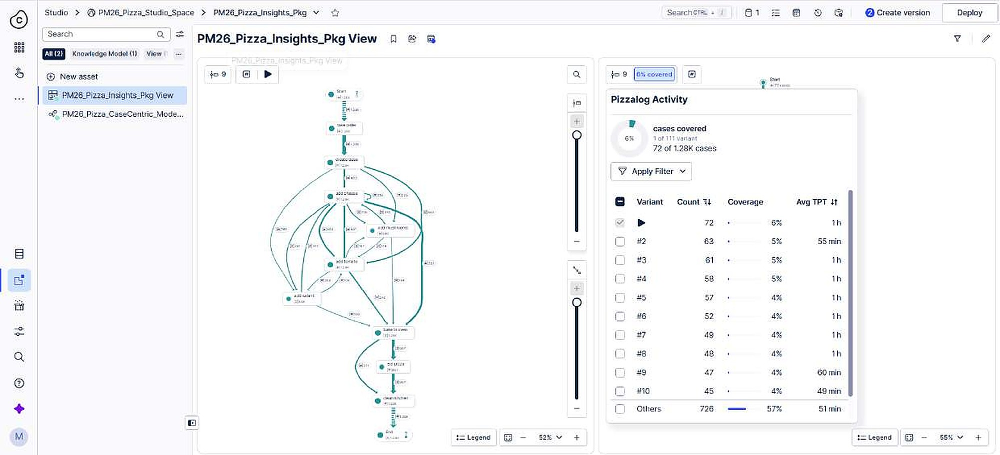
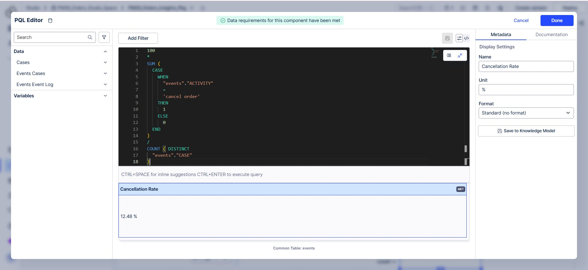
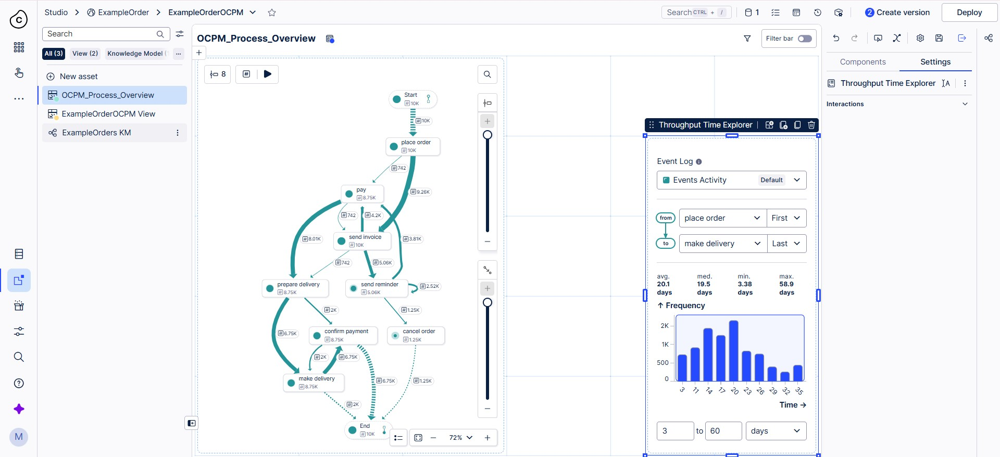

# Technical Dashboard Creation in Celonis

Process Mining Seminar | TH Köln | M.Sc. Digital Sciences | Group 07 | 9 November 2026

Authors: Malik Mohsin Azhar, Samira Aghajani, Mohammed Suhan

This repository documents how we built process-mining dashboards in Celonis, from raw files to a deployed dashboard. It contains the data, the PQL formulas, the screenshots, a step-by-step runbook and a Python script that checks our results.

## Results

| Part | Dataset | Result |
|---|---|---|
| 1 | Pizza event log | 1,278 cases, 111 variants, most common variant 72 cases (6%) |
| 2 | 10,000 orders (cases + events) | Total Cases 10,000, Cancellation Rate 12.48% |
| 3 | Object-centric example (order, item, package) | Perspective `PM26OCPMOrderPerspective`, Order to Delivery 20.17 days |

## Repository structure

```
.
├── README.md
├── docs/
│   └── Runbook.md              Step-by-step guide (P1-01 to B3-14)
├── slides/
│   └── Celonis_Seminar_Group07_Final.pptx
├── data/
│   ├── pizza-log.csv           Part 1
│   ├── table-10000-cases.xlsx  Part 2 (one row per order)
│   ├── table-10000-events.xlsx Part 2 (one row per event)
│   └── ocpm/                   Part 3 object-centric data
│       ├── Events.csv          2,244 events
│       ├── OT_*.csv            Objects: order, item, package
│       └── E2O_*.csv           Event-to-object links
├── pql/                        PQL formulas used in the dashboards
├── analysis/
│   └── verify_kpis.py          Recomputes the KPIs from the raw data
└── screenshots/
    ├── part1/
    ├── part2/
    └── part3/
```

## Pipeline

```
Raw files -> Data Pool -> Data Model -> Studio (space, package, view) -> Version and deploy -> Apps
```

Each stage has one job. If a dashboard looks wrong, check the stages in this order.

## Part 1: Pizza event log

One table with three columns: case, activity and timestamp. It teaches the full flow: upload, import, data model, load, Studio, deploy.



## Part 2: Orders dashboard

Two tables linked by a 1:N foreign key on `CASE`. The events table is the activity table, because one order has many events. The dashboard has a Process Explorer, KPI cards, an OLAP table, a bar chart, a Resource filter and export to Excel.



## Part 3: Object-centric view

In Parts 1 and 2 every event belongs to one case. In the object-centric data one event can involve an order, several items and a package. We created the perspective `PM26OCPMOrderPerspective` with all three objects and built the view `OCPM_Process_Overview`.

Why it matters: with items as the case, each `place order` event is copied once per item. 200 real events become 791 (convergence). Object-centric process mining stores each event once and links it to every object.



## PQL formulas

| File | KPI | Result |
|---|---|---|
| [`01_total_cases.pql`](pql/01_total_cases.pql) | Total Cases | 10,000 |
| [`02_cancellation_rate.pql`](pql/02_cancellation_rate.pql) | Cancellation Rate | 12.48% |
| [`03_order_to_delivery_days.pql`](pql/03_order_to_delivery_days.pql) | Order to Delivery | 20.17 days |

## Verify the results

The script recomputes the KPIs from the raw files with pandas, independently of Celonis.

```bash
pip install -r requirements.txt
python analysis/verify_kpis.py
```

Output:

```
Part 2: orders dashboard
  Total Cases:            10,000
  Cancellation Rate:      12.48%

Part 3: throughput time, place order (first) to make delivery (last)
  PQL KPI (whole days):   20.17 days
  Median:                 19.52 days
  Min / max:              3.32 / 58.91 days

Part 3: object-centric data
  Objects:                200 orders, 791 items, 128 packages
  'place order' events:   200 real, 791 if item is the case (convergence)
```

Total Cases, Cancellation Rate and Order to Delivery match Celonis exactly. The pizza variant count differs slightly (134 in pandas, 111 in Celonis) because 34 events share a timestamp with another event of the same case, and the order of tied events decides the variant.

## References

- Process Mining (PMI), WiSe 26/27, TH Köln: ILIAS course material and ProcessMining YouTube course
- van der Aalst, W. (2016). *Process Mining: Data Science in Action*. Springer
- van der Aalst, W. et al. (2012). Process Mining Manifesto. In: *Business Process Management Workshops*, Part I, LNBIP 99, pp. 169-194. Springer
- Celonis documentation: [CALC_THROUGHPUT](https://docs.celonis.com/en/calc_throughput.html)
